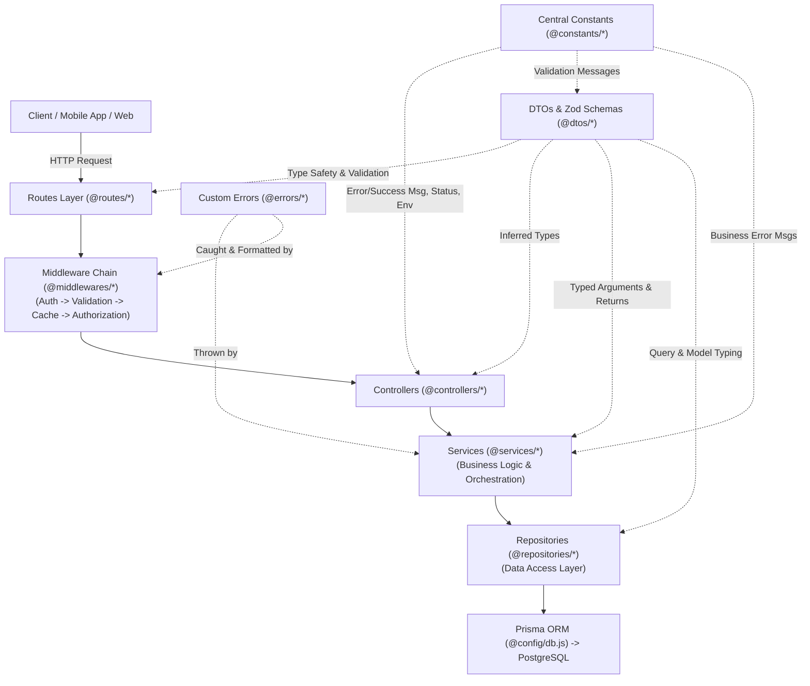

# Colosseum Backend — Architecture, Design Patterns & Coding Rules

> This document defines the architectural standards, design patterns, coding conventions, and best practices derived from `debugging-diaries-backend` and adapted for the **Colosseum Audio Tour Guide** backend services (`ColosseumBackend`).
> Every feature, module, and endpoint must strictly comply with these rules.

---

## 1. Core Architecture & Layered Unidirectional Flow

The backend follows a strict **Layered N-Tier Architecture** with a unidirectional data flow:



### The Unidirectional Chain Rule
$$\mathbf{Routes} \longrightarrow \mathbf{Middlewares} \longrightarrow \mathbf{Controllers} \longrightarrow \mathbf{Services} \longrightarrow \mathbf{Repositories} \longrightarrow \mathbf{Database (Prisma)}$$

- **No skipping layers:** Controllers **MUST NEVER** call Repositories or Prisma directly. They must always talk to Services.
- **Prisma isolation:** Only the **Repository** layer is allowed to import and call `prisma` (`@config/db.js`). Services, controllers, and middlewares must never invoke Prisma queries directly.
- **DTOs across all layers:** Inputs and outputs across the chain must be strictly typed using DTO interfaces inferred from Zod schemas (`@dtos/*`).

---

## 2. Layer Responsibilities & Implementation Rules

### Layer 1: DTOs & Validation Schemas (`@dtos/*`)
1. **Zod as Single Source of Truth:**
   - Every request payload (body, query, params) must have a Zod schema.
   - Use `.pick()`, `.extend()`, `.partial()`, and `.omit()` on base domain schemas for code reuse and consistency.
2. **Type Inference:**
   - Always export inferred TypeScript types from schemas:
     ```typescript
     export const LandmarkSchema = z.object({ ... });
     export const CreateLandmarkSchema = LandmarkSchema.pick({ ... });
     export type Landmark = z.infer<typeof LandmarkSchema>;
     export type CreateLandmark = z.infer<typeof CreateLandmarkSchema>;
     ```
3. **Common/Shared DTOs:**
   - Place generic ID validation and pagination schemas in `commonItemDTO.ts`:
     ```typescript
     export const IdSchema = z.object({
       id: z.coerce.number({ message: Message.id }),
     });
     export const BaseQuerySchema = z.object({
       page: z.coerce.number().int().min(1).default(1),
       limit: z.coerce.number().int().min(1).max(100).default(10),
       sortBy: z.string().optional(),
       sortOrder: z.enum(['asc', 'desc']).optional(),
     });
     ```
4. **Validation Messages:**
   - Never hardcode validation messages inside Zod schemas. Always import from `@constants/messageConstants.js` (`MessageConstants.validation.*`).

---

### Layer 2: Routing Layer (`@routes/*`)
1. **Router Instantiation:**
   - Use `express.Router()`.
   - Instantiate the corresponding controller once at the top of the file:
     ```typescript
     const router = express.Router();
     const landmarkController = new LandmarkController();
     ```
2. **Chained Route Definitions:**
   - Prefer `router.route('/path')` for organizing identical paths with different HTTP methods (`get`, `post`, `patch`, `delete`).
   - Group shared path middlewares using `.all(...)`:
     ```typescript
     router
       .route('/:id')
       .all(Validator.params(CommonItemDTO.IdSchema), authenticateToken)
       .get(cacheMiddleware('landmarks'), landmarkController.GetLandmarkByID)
       .patch(authorizeRole.adminOnly, Validator.body(LandmarkDTO.UpdateSchema), landmarkController.UpdateLandmark)
       .delete(authorizeRole.adminOnly, landmarkController.RemoveLandmark);
     ```
3. **Execution Order of Route Middleware:**
   1. `authenticateToken` (verify identity)
   2. `Validator.params / query / body` (validate input)
   3. `cacheMiddleware` (serve cached responses if applicable)
   4. `authorizeRole.*` (verify permissions on resource)
   5. `controller.MethodName` (handle request)

---

### Layer 3: Middlewares (`@middlewares/*`)
1. **Request Validation (`requestValidator.ts`):**
   - Higher-order middlewares `Validator.body(schema)`, `Validator.params(schema)`, `Validator.query(schema)`.
   - Parse using `schema.safeParse(...)`.
   - On error: pass error directly to `next(ParsedData.error)`.
   - On success: store validated data on typed request fields: `req.validatedBody`, `req.validatedParams`, `req.validatedQuery`.
2. **Request Type Extension (`@types/expressDefaultTypes.ts`):**
   - Extend Express `Request` interface:
     ```typescript
     declare module 'express-serve-static-core' {
       interface Request {
         user?: AuthDTO.AuthPayload;
         validatedBody?: any;
         validatedParams?: any;
         validatedQuery?: any;
       }
     }
     ```
3. **Authentication (`authenticateToken.ts`):**
   - Read token from HTTP-only cookie (`req.cookies.authToken`) or `Authorization: Bearer <token>`.
   - Verify JWT using `EnvConstant.JWT_SECRET`.
   - Attach payload to `req.user`.
   - Throw/pass `AuthenticationError` on missing or invalid tokens.
4. **Authorization (`authorizeRoles.ts`):**
   - Check user role or resource ownership.
   - ADMIN roles bypass resource ownership checks.
   - Non-admin users can only mutate/delete resources they own.
   - Throw `AuthorizationError` (403) or `NotFoundError` (404) if resource does not exist.
5. **Caching (`redisCache.ts`):**
   - Intercept GET requests and serve cached JSON if key exists in Redis.
   - Automatically bypass on cache miss and store response.
6. **Global Error Handler (`errorHandler.ts`):**
   - Express 4-argument error middleware `(err, req, res, next)`.
   - Maps `BaseError` $\to$ `err.statusCode` & `err.message`.
   - Maps `ZodError` $\to$ `400 Bad Request` & comma-separated error messages.
   - Fallback $\to$ `500 Internal Server Error`.
   - Only attaches `stack` if `EnvConstant.NODE_ENV === 'development'`.
   - Dispatches output via `ResponseHandler.send(...)`.

---

### Layer 4: Controllers (`@controllers/*`)
1. **Class-Based Structure with Bound Arrow Functions:**
   - Define controllers as classes.
   - All action methods must be arrow functions to preserve `this` context when passed as Express handlers:
     ```typescript
     export default class LandmarkController {
       private landmarkService: LandmarkService;

       constructor() {
         this.landmarkService = new LandmarkService();
       }

       GetLandmarkByID = async (req: Request, res: Response) => {
         const id = req.validatedParams.id;
         const landmark = await this.landmarkService.GetLandmarkByID(id);
         ResponseHandler.send(res, HttpStatus.OK.code, { data: landmark });
       };
     }
     ```
2. **Responsibilities:**
   - Extract validated input strictly from `req.validatedParams`, `req.validatedQuery`, `req.validatedBody`, or `req.user`.
   - Call the corresponding `Service` method.
   - Invalidate Redis caches on mutating actions (`clearCachePattern('landmarks:*')`).
   - Format and return response using `ResponseHandler.send(...)`.
   - **No Try/Catch boilerplate:** In Express 5, unhandled promise rejections are automatically passed to the next error middleware. Avoid redundant `try { ... } catch (err) { next(err); }` unless custom error decoration is strictly required.

---

### Layer 5: Services (`@services/*`)
1. **Class-Based Encapsulation:**
   - Encapsulate all business logic, workflow coordination, and rules inside Services.
   - Inject or instantiate repositories (`this.landmarkRepository = new LandmarkRepository();`) and any secondary services (e.g. `AudioService`, `AIService`).
2. **Strict Typing with DTOs:**
   - Every service method must explicitly define argument types and return types using DTO types:
     ```typescript
     async CreateLandmark(data: LandmarkDTO.Create): Promise<LandmarkDTO.Landmark>
     async GetAllLandmarks(query: LandmarkDTO.Query): Promise<{ landmarks: LandmarkDTO.Landmark[]; total: number }>
     ```
3. **Error Handling via Domain Exceptions:**
   - When an entity is not found or validation fails at domain level, throw concrete errors from `@errors/concreteErrors.js`:
     ```typescript
     if (!landmark) {
       throw new Error.NotFoundError(Message.landmarkNotFound);
     }
     ```
   - Never return `res.status(...)` or HTTP objects from a service.

---

### Layer 6: Repositories (`@repositories/*`)
1. **Database Isolation with Prisma:**
   - All Prisma queries (`prisma.<model>.findUnique`, `prisma.<model>.findMany`, `prisma.<model>.create`, etc.) are strictly contained in Repositories.
   - Services must never write raw Prisma queries.
2. **CRUD & Query Conventions:**
   - **Pagination:** Always calculate `skip = (page - 1) * limit` and set `take: limit`.
   - **Sorting:** Default sorting with fallback: `orderBy: { [sortBy || 'created_at']: sortOrder || 'desc' }`.
   - **Soft Delete:** Filter soft-deleted records: `where: { is_deleted: false, ... }`.
   - **Relational Operations:** Use Prisma `connect` and `set` for related models (e.g. categories, audio stops, viewpoints).
   - **Parallel Counts:** When querying lists with pagination, use `Promise.all([prisma.model.findMany(...), prisma.model.count(...)])` to retrieve data and total records efficiently.

---

## 3. Error Handling Hierarchy

All application errors inherit from `BaseError`:

```
BaseError (statusCode, message, stack)
 ├── BadRequestError (400)
 ├── AuthenticationError (401)
 ├── AuthorizationError (403)
 ├── NotFoundError (404)
 ├── ConflictError (409)
 ├── ExpiredError (401)
 └── InternalServerError (500)
```

### Implementation Rules
- Define error classes in `@errors/concreteErrors.js` extending `BaseError`.
- Error messages must default to constants in `HttpConstants.statusCode.<CODE>.message` or `MessageConstants.errorMessage.*`.
- The global error handler catches all thrown errors and formats a uniform JSON response.

---

## 4. Response Standardization

All responses from controllers must use `ResponseHandler.send(...)`:

```typescript
ResponseHandler.send(res, statusCode, {
  data?: any,
  message?: string,
  stack?: any
});
```

### Uniform JSON Response Shape
- **Data Response:**
  ```json
  {
    "payload": { ... } // or raw data array/object
  }
  ```
- **Success with Message:**
  ```json
  {
    "payload": { ... },
    "message": "Landmark updated successfully"
  }
  ```
- **Error Response (via errorHandler):**
  ```json
  {
    "message": "Landmark not found",
    "stack": "Error: Landmark not found\n    at LandmarkService..." // only in development
  }
  ```

---

## 5. Constants & Configuration Architecture

Never use hardcoded magic strings or numbers in business logic, routes, or schemas.

### Central Directory Structure (`@constants/*`)
- `envConstants.ts`: Loads and exports typed environment variables (`PORT`, `DATABASE_URL`, `JWT_SECRET`, `REDIS_URL`, etc.).
- `httpConstants.ts`: HTTP status codes with numeric `code`, `status` string ('success'/'fail'/'error'), and default message.
- `messageConstants.ts`: Central message dictionary split by domain:
  - `validation`: Zod error messages.
  - `responseMessage`: Success messages per controller.
  - `errorMessage`: Error messages per service.
- `allConstant.ts`: Barrel export for all constants:
  ```typescript
  export { default as EnvConstant } from './envConstants.js';
  export { default as MessageConstants } from './messageConstants.js';
  export * as HttpConstants from './httpConstants.js';
  ```

---

## 6. Security, Authentication & Session Standards

1. **Tokens in HTTP-Only Cookies:**
   - JWT tokens must be stored in secure, `httpOnly`, `sameSite: 'lax'` (or `'strict'`) cookies named `authToken`.
2. **Access Control Hierarchy:**
   - `ADMIN`: Full CRUD privileges on all monuments, viewpoints, tours, and users.
   - `USER`: Read public tours, manage their own bookmarks, audio history, and reviews.
3. **Password Security:**
   - Always hash passwords with `bcrypt` (minimum 10 salt rounds) inside AuthService before storing.

---

## 7. Caching Strategy (Redis)

1. **Read Endpoints:**
   - Attach `cacheMiddleware('key-prefix')` to frequently read GET routes (e.g. monuments list, viewpoint details, audio metadata).
2. **Cache Invalidation:**
   - On any mutation (`create`, `update`, `delete`, `restore`), controllers must call `clearCachePattern('<prefix>:*')` to purge stale cache entries immediately.

---

## 8. TypeScript & Module Conventions

1. **ESM (ECMAScript Modules):**
   - Project uses `"type": "module"` with NodeNext module resolution.
   - **Mandatory:** All relative and path-aliased local file imports must explicitly end with `.js`:
     ```typescript
     import LandmarkService from '@services/landmarkService.js';
     import * as LandmarkDTO from '@dtos/landmarkDTO.js';
     ```
2. **Path Aliases:**
   - Always use `@`-prefixed path aliases as configured in `tsconfig.json`:
     - `@controllers/*`
     - `@services/*`
     - `@repositories/*`
     - `@dtos/*`
     - `@middlewares/*`
     - `@constants/*`
     - `@config/*`
     - `@errors/*`
     - `@utils/*`
     - `@types/*`
3. **No `any` Rule:**
   - Strict typing across all layers. The only permitted exception is the module augmentation for generic Express request properties in `expressDefaultTypes.ts`.

---

## 9. Unit Testing Standards (Vitest)

1. **Test Organization:**
   - Place unit tests in `src/test/controllers/*.test.ts` and `src/test/services/*.test.ts`.
   - Separate test types into `src/types/*TestTypes.ts`.
2. **Isolation & Mocking:**
   - Tests must run in isolation without connecting to a live PostgreSQL or Redis instance.
   - Mock all dependencies using `vi.mock(...)` and `vi.fn()`:
     - In controller tests: mock the Service and `ResponseHandler`.
     - In service tests: mock the Repository and secondary services.
3. **Test Fixtures:**
   - Use reusable mock builders for HTTP objects:
     ```typescript
     const buildReq = (overrides: Partial<Request> = {}): Request => ({
       validatedQuery: {},
       validatedParams: {},
       validatedBody: {},
       user: undefined,
       ...overrides,
     }) as unknown as Request;

     const buildRes = (): Response => {
       const res = {} as Response;
       res.cookie = vi.fn().mockReturnValue(res);
       res.status = vi.fn().mockReturnValue(res);
       res.json = vi.fn().mockReturnValue(res);
       return res;
     };
     ```

---

## 10. Summary Checklist for Every New Backend Feature

Before committing any new backend feature in `ColosseumBackend`, verify:

- [ ] **DTO Created:** Zod schema defined in `@dtos/`, with inferred types exported and messages imported from `@constants/messageConstants.js`.
- [ ] **Repository Created:** Database operations implemented in `@repositories/` using `prisma`. No raw Prisma queries in services or controllers.
- [ ] **Service Created:** Business logic, composition, and domain error checks implemented in `@services/`. Custom errors thrown from `@errors/concreteErrors.js`.
- [ ] **Controller Created:** Class methods defined as arrow functions in `@controllers/`. Uses `req.validated*`, calls service, clears cache on mutations, dispatches via `ResponseHandler.send`.
- [ ] **Routes Configured:** Endpoints defined in `@routes/` chaining `authenticateToken`, `Validator.*`, `cacheMiddleware`, `authorizeRoles`, and controller methods.
- [ ] **Constants Updated:** Added validation, success, and error messages to `@constants/messageConstants.js`.
- [ ] **ESM Extension:** Every local import uses `.js` extension.
- [ ] **Tests Added:** Unit tests written with Vitest in `src/test/` for service and controller.
